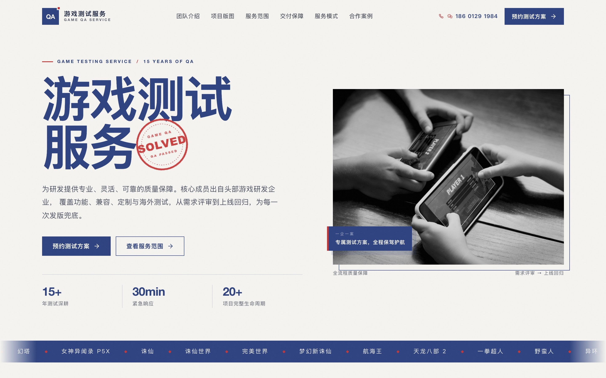

# 游戏测试服务 · 品牌官网

根据《游戏测试服务》方案（15 页）整理制作的单页品牌 / 服务官网。视觉延续原方案的纸张底色、深海军蓝与红色印章，改成适合网页浏览的版式，并补齐移动端与交互。



## 本地预览

直接双击 `index.html` 即可打开；也可以用本地静态服务（推荐，避免个别浏览器对 `file://` 的限制）：

```bash
cd NewTeam
python3 -m http.server 8000
# 打开 http://localhost:8000
```

## 目录结构

```
NewTeam/
├── index.html                 # 单页站点（全部文案与结构）
├── 404.html                   # 品牌化 404 页
├── .nojekyll                  # 关闭 Jekyll，GitHub Pages 原样发布
├── assets/
│   ├── css/style.css          # 设计系统、版式、响应式、动效
│   ├── js/main.js             # 导航、滚动揭示、计数器、复制号码、移动端抽屉
│   ├── favicon.svg
│   └── img/                   # 从原方案中提取并重新压缩的照片（12 张）+ 分享封面
├── tools/make-og-cover.py     # 生成 1200×630 分享封面
├── preview/                   # 桌面端 / 移动端预览图
└── README.md
```

## 页面结构

| 板块 | 内容 | 对应原方案 |
| --- | --- | --- |
| 首屏 | 游戏测试服务 / 质量保障主张 / 关键数字 | P1 封面 |
| 01 团队介绍 | 15 年经验、核心成员背景、项目量级 | P3–P4 |
| 02 项目版图 | 平台 / 类型 / 市场 + 26 个项目名 | P5 |
| 03 服务范围 | 功能测试、兼容测试、定制 & 海外测试 | P6–P7 |
| 04 交付保障 | 过程保障、成果交付、安全保密 + 4 个 KPI | P8–P9 |
| 05 服务模式 | 项目制外包、人员外包、任务型 / 模块化 | P10–P11 |
| 06 合作案例 | 野蛮人（全流程托管）、异环（任务型） | P12–P14 |
| 联系 | 期待合作、王萌 186 0129 1984、复制号码、查看合作案例 | P15 |

## 设计说明

- **色板取自原方案封面**：纸色 `#F5F4F0`、海军蓝 `#2E4280`、印章红 `#C63635`。
- **字体**：中文使用系统黑体（PingFang SC / HarmonyOS Sans / 思源黑体 / 微软雅黑），英文使用 Helvetica / Arial Black，无外链字体依赖。
- **照片**：从原方案中提取后统一转灰度、压缩为 JPG，保持原方案的质感。
- **印章**：`SOLVED` 印章用 SVG 重绘，叠加 `feTurbulence` 位移滤镜做出盖章毛边，可无损缩放。
- **动效**：滚动淡入、数字递增、项目名跑马灯；均遵循 `prefers-reduced-motion`。

## 交互与可用性

- 固定导航 + 滚动高亮当前板块；移动端抽屉菜单（Esc / 点击遮罩关闭，打开时锁定页面滚动）。
- 电话按钮 `tel:` 可直接拨打；「复制号码」带 Toast 提示（含降级方案）。
- 首屏与页脚均提供预约入口。
- 语义化标签、跳转链接、图片 `alt`、键盘焦点样式。
- 无 JS 时内容仍然完整可见（滚动揭示仅在 `.js` 下生效）。

## 需要替换 / 确认的地方

1. **品牌名**：原方案未提供公司名，顶部暂时使用「游戏测试服务 / GAME QA SERVICE」作为品牌位。替换 `index.html` 中 `.brand` 的文案即可；如提供 Logo，可替换 `.brand-mark`。
2. **联系方式**：目前使用原方案尾页的王萌 `186 0129 1984`，全站共 6 处 `tel:+8618601291984`，改名或换号时请一并修改。
3. **案例游戏截图**：野蛮人 / 异环的两张圆形缩略图来自原方案，版权归对应项目方；对外发布前请确认可用范围。
4. **项目清单**：`index.html` 中 `.wall-list` 可直接增删项目名。

## 手机端适配

- 已在 390 / 375 / 360 / 320 px 竖屏以及 844 × 390 横屏下检查：无横向滚动、无报错。
- 移动端底部「电话咨询 / 预约方案」条：向下滚动时自动收起，向上滚动恢复；滚到「期待合作」板块时自动隐藏，避免遮挡联系方式。
- 触屏设备禁用卡片 hover 位移与图片彩色态，防止点按后“粘住”；按钮与菜单点击区不小于 44px。
- 移动端抽屉菜单支持 Esc / 点击遮罩关闭，底部附带电话与预约入口。
- 横屏手机单独压缩首屏标题与间距，避免只看到标题。

## 在线地址

| | |
| --- | --- |
| 正式站点 | **https://zhizhuer9110.github.io/game-qa-site/** |
| 代码仓库 | https://github.com/zhizhuer9110/game-qa-site |
| 托管方式 | GitHub Pages，发布源 `main` 分支根目录（Deploy from a branch），纯静态、无构建 |
| 发布延迟 | push 后约 1 分钟自动更新 |
| 部署依赖 | 无。不依赖 GitHub Actions，不消耗 Action 分钟数 |

### 首次部署（只做一次）

仓库 → **Settings** → **Pages** → *Build and deployment*：

- **Source**：`Deploy from a branch`
- **Branch**：`main`，目录 `/ (root)` → **Save**

保存后 1~2 分钟内站点上线。之后每次 `git push` 自动重新发布，不需要再动任何设置。

### 更新网站

改完文件后提交推送即可，Pages 会自动重新发布：

```bash
git add -A
git commit -m "更新文案"
git push
```

### 部署相关文件

- `.nojekyll`：跳过 Jekyll 处理，资源按原样发布，部署更快、不会误吞下划线开头的文件。
- `404.html`：站内不存在的路径显示品牌化 404 页（含返回首页与电话入口）。
- `assets/img/og-cover.jpg`：1200 × 630 的微信 / 飞书 / 社交分享封面，由 `tools/make-og-cover.py` 生成；改动主标题或关键数字后重跑一次即可。
- `index.html` 的 `og:url` / `og:image` / `canonical` 使用绝对地址，因为社交平台不解析相对路径；**若更换域名或仓库名，这 4 处需同步修改**。
- `.gitignore` 排除了本地打包的 `game-qa-service-site.zip` 与 `.cache/`。

### 容量与访问

- 仓库约 1–2 MB，远低于 GitHub 单文件 100 MB / 单站 1 GB 限制。
- Pages 月流量软限制 1 TB，静态页面日常投放足够；如后续增加较大的展示素材，建议放对象存储（OSS / COS）并只保留链接。
- **国内可达性**：`*.github.io` 在部分地区和运营商存在干扰、延迟高甚至打不开的情况。面向国内客户正式投放时，建议绑定自定义域名 + 国内 CDN，或用 Cloudflare Pages 做镜像站点。

## 本地预览与临时分享

- 本地：`python3 -m http.server 8000`，打开 http://localhost:8000 （直接双击 `index.html` 也可，但 `file://` 在个别浏览器下有限制）。
- 同一 Wi-Fi 的同事：启动 `python3 -m http.server 4173` 后访问 `http://<本机局域网 IP>:4173`。
- 临时公网链接：运行 `./share.sh <cpolar-authtoken>`，脚本会下载 cpolar 并生成 `https://*.cpolar.cn` 链接（authtoken 在 [cpolar](https://www.cpolar.com/) 免费注册后获取）。
- 已有长期地址后，`share.sh` 仅用于本地演示，不建议替代正式站点。

## 兼容与验证

- 已在 Chromium 内核下按 1440 / 1280 / 1024 / 834 / 768 / 390 px 六档宽度检查：无横向滚动、无控制台报错、12 张图片全部加载。
- 使用现代 CSS（Grid、`clamp()`、`aspect-ratio`、`backdrop-filter`），支持 Safari 15.4+ / Chrome 90+ / Edge 90+ / Firefox 90+。
- 纯静态，无构建步骤；部署时把 `index.html` 与 `assets/` 一起上传到任意静态托管即可（Nginx、OSS、Vercel、GitHub Pages 等）。

## 说明

页面内容依据原方案整理与改写，未引入原方案之外的事实性承诺。「30 分钟响应」「提前 3 个工作日」「15 年」「千万级用户」均出自原方案；「20+ 项目完整生命周期」依据方案中的项目清单整理（清单列有 26 个项目）；「6 大品类」对应方案列出的 MMORPG / ARPG / SLG / FPS / 休闲 / 动作。

页面不含表单和后端，转化入口为电话、复制号码与预约入口；如需收集线索，可后续接入表单服务。
