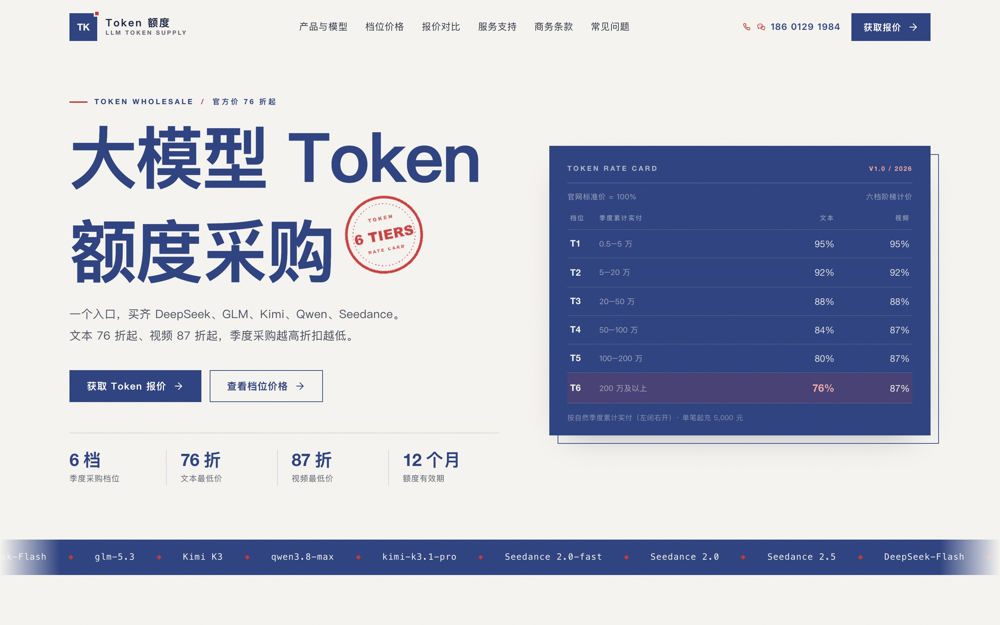

# 大模型 Token 额度采购 · 落地页

依据《Token 业务说明（含报价对比）v1.1（有效期至 2026.11.30）》整理制作的单页落地页。v1.1 的价格数字与 v1.0 一致，仅将对外报价有效期调整为 2026-11-13 至 2026-11-30。首屏按“卖 Token 额度”的广告位处理：大标题直接说清产品，下面给出 76 折起、文本 / 视频折扣和报价入口。视觉沿用游戏测试服务官网的设计系统：纸色 `#F5F4F0`、海军蓝 `#2E4280`、印章红 `#C63635`。



## 本地预览

```bash
# 在仓库根目录（NewTeam/）执行
python3 -m http.server 8000
# 打开 http://localhost:8000/token/
```

也可以直接双击 `token/index.html`；个别浏览器对 `file://` 下的下载与剪贴板有限制，建议用本地静态服务。

## 目录

```
token/
├── index.html                        # 单页站点（全部文案与结构）
├── assets/
│   ├── token.css                     # 设计系统、版式、响应式、动效
│   ├── token.js                      # 导航、滚动揭示、计数器、报价试算、复制号码
│   ├── favicon.svg
│   └── og-cover.jpg                  # 1200×630 分享封面
└── preview/                          # 桌面端 / 移动端首屏预览
```

## 页面结构

| 板块 | 内容 | 对应原文 |
| --- | --- | --- |
| 首屏 | 大模型 Token 额度采购 / 76 折起 / 六档费率卡 | P1 标题与 1.1 |
| 01 产品与模型 | 模式说明、7 个文本型号、5 个视频型号、交付内容 | 1.1–1.3 |
| 02 档位价格 | 让利阶梯图、六档表、六条规则、视频封顶说明 | 2.1–2.2 |
| 03 报价对比 | 报价试算、10 万额度实付对比、文本/视频逐型号价目、渠道对比 | 3.1–3.4 |
| 04 服务与支持 | 开通、查询、对账、技术支持、SLA 状态 | 四 |
| 05 商务条款 | 计价、档位、账期、退款、有效期 | 五 |
| 06 常见问题 | Q1–Q11 | 六 |
| 联系 | 王萌 186 0129 1984 / 复制号码 / 查看档位价格 | — |

## 设计与内容说明

- **设计系统**：与 `assets/css/style.css` 同一套颜色、字体、按钮、描边数字、粗糙印章与滚动揭示；Token 页使用独立的 `token.css`，方便单独部署。
- **图形化**：原文的档位表改为「让利幅度」柱状图（文本 5%→24%，视频 5%→13%，T4 起封顶），价目表用海军蓝列强调 T6；没有使用照片素材，避免引入与业务无关的图片。
- **报价试算**：新增一个按原文规则工作的计算器：输入季度累计实付，输出命中档位、文本/视频折扣与估算到手额度（到手额度 = 实付 ÷ 折扣率）。默认 300,000 元 → T3 88%。
- **价格口径**：v1.1 与 v1.0 的公开价格数字一致，仅报价有效期调整为 2026-11-13 至 2026-11-30。
- **DeepSeek 时段价**：DeepSeek 分空闲 / 高峰两档，高峰输入、输出为空闲价的 2 倍；价目表拆成「空闲时 / 高峰时」两行，其余型号两档同价。
- **对外口径**：原文中的内部表述（如“销售侧不得自行承诺”“不能当全品类最低价讲”、视频毛利差额）改写为对客户可读的说法；未新增与原文冲突的价格承诺。
- **联系方式**：原文未包含联系人，沿用现有官网的「王萌 / 186 0129 1984 / 微信同号」。如需更换，搜索 `186 0129 1984` 与 `18601291984` 替换即可。

## 部署

- 若与游戏测试服务站同仓库部署：保持 `token/` 目录不变，访问 `https://zhizhuer9110.github.io/game-qa-site/token/`。
- `index.html` 里的 canonical、`og:url`、`og:image` 目前按上述地址写死；如果改为独立域名或放到根目录，需要同步替换这三处绝对地址。
- 修改 CSS / JS 后，更新 `index.html` 末尾的 `?v=...` 查询参数以刷新缓存。
